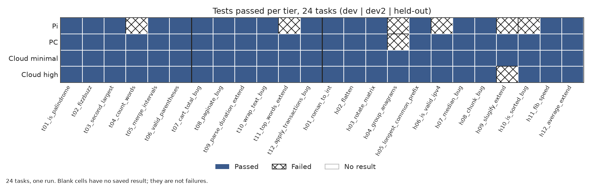
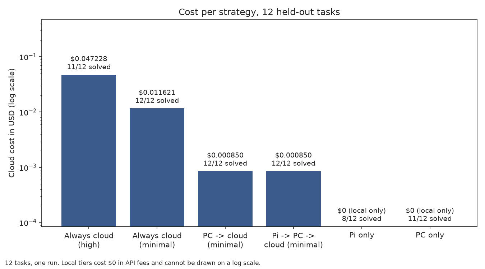
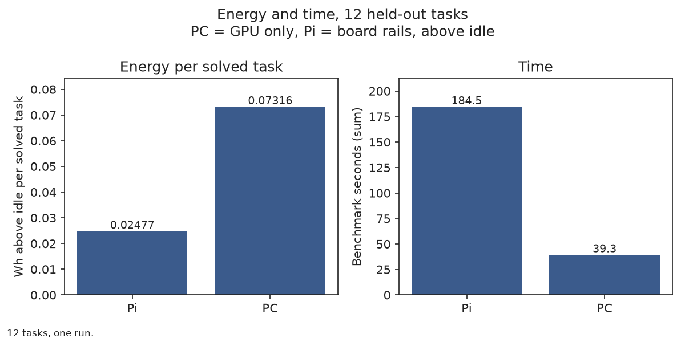

# pi-edge-router

Eco mode for AI coding: let the tests choose the model, cheapest first.

A developer who pays per token runs each coding task up a ladder: a Raspberry Pi 5, then a PC GPU, then the cloud at minimal effort, then the cloud at high effort. Every answer is checked against the developer's own tests, and the task stops at the cheapest rung that passes.

Built for the Meta Global AI Developer Hackathon (Oct 26 – Nov 4, 2026). Work in progress.

## Before the hackathon vs during the hackathon

Kickoff was Oct 26, 2026 at 12:00 PM ET. The git tag `pre-hackathon` marks the last commit made before kickoff.

**Before kickoff (prior work, everything up to the tag):**
- Raspberry Pi 5 setup: OS, SSH, llama.cpp build, Llama 3.2 3B Q4_K_M speed measurements
- Design note v1 (docs/design.md)
- A first router script (router.py) with a confidence threshold, refusal phrases and a rule for letter questions. The cloud call was a placeholder that returned nothing.
- A local evaluation script and two held-out question sets with results

**During the hackathon (commits after the tag):**
- Everything else. Nothing that talks to Meta Model API existed before kickoff.

To see exactly what was added during the event: `git log pre-hackathon..main --oneline`, or [compare the tag with main](https://github.com/MooreHaww/pi-edge-router/compare/pre-hackathon...main).

## Scope

This works for tasks whose answers can be verified, such as code with tests. It makes no claim about tasks that have no tests. The code sandbox is a subprocess with a time limit and a blocklist of imports and calls. It is not a real sandbox.

## Results so far

Coding tasks, held-out set: 12 tasks, one run each. Figures come from `simulate_router.py`. The baseline is always-cloud at minimal effort. Models: Pi = Llama 3.2 3B Q4_K_M, PC = Qwen3 14B Q4_K_M, cloud = Muse Spark 1.3.



Which tier passed each of the 24 small single-function tasks (dev, dev2, held-out). Each tier ran each task once.



Cloud cost per strategy on the 12 held-out tasks, from one run. The held-out set has now been used for this comparison.

| Strategy | Solved | Cost USD | Seconds | Saving vs always-cloud minimal |
|---|---|---|---|---|
| Always cloud (high) | 11/12 | 0.047228 | 75.6 | |
| Always cloud (minimal) | 12/12 | 0.011621 | 25.1 | |
| Pi only | 8/12 | 0.000000 | 213.1 | |
| PC only | 11/12 | 0.000000 | 39.4 | |
| PC -> cloud (minimal) | 12/12 | 0.000850 | 41.3 | 92.7% |
| Pi -> PC -> cloud (minimal) | 12/12 | 0.000850 | 229.0 | 92.7% |

On the held-out set, PC -> cloud (minimal) solved all 12 tasks for $0.000850, compared with $0.011621 for always-cloud at minimal effort.

Limits of these results:
- Across all 24 tasks (dev, dev2 and held-out), the PC failed only one (`h04_group_anagrams`), so only 1 of 24 tasks reached the cloud. The savings come almost entirely from the PC tier.
- The tasks are small single functions.
- There are 12 tasks per held-out set, and each was run once.
- The held-out set has now been used for comparison, so any further tuning needs a new, unseen task set.

### Energy

From `energy_report.py`, held-out tasks, 12 tasks, one run. Energy is measured above idle, and electricity is priced at $0.15 per kWh.



Energy above idle per solved task, and total benchmark time, on the 12 held-out tasks from one run. PC energy is GPU only and Pi energy is board rails, so the two are not measured the same way.

| | Solved | Benchmark s | Wh | Wh per solved task | Electricity USD |
|---|---|---|---|---|---|
| PC | 11/12 | 39.3 | 0.80476 | 0.07316 | 0.00012071 |
| Pi | 8/12 | 184.5 | 0.19814 | 0.02477 | 0.00002972 |
| Pi -> PC (estimate) | 11/12 | 198.5 | 0.48482 | 0.04407 | 0.00007272 |

Cloud at minimal effort for the same 12 tasks cost $0.011621.

Limits of the energy numbers:
- **PC energy is GPU only**, read from nvidia-smi. **Pi energy is the board power rails**, read from vcgencmd. The two are not measured the same way.
- **Cloud energy is not published**, so no energy comparison with the cloud is made.
- **Idle values:** PC idle is the mean of a separate idle log (37.45 W). Pi idle is a constant 1.88 W, the mean of six manual readings.
- **Sample intervals are nominal** (PC 0.5 s, Pi 1.0 s). The PC timestamps actually average 0.509 s apart.
- **The power logs run longer than the benchmarks:** the PC log covers 62.0 s and the Pi log 300.0 s, against 39.3 s and 184.5 s of tasks. Energy above idle outside the tasks is included.
- **The Pi -> PC row is an estimate:** it splits the PC's energy across tasks in proportion to each task's seconds.

## How to run

All commands below are PowerShell, run from the repo root, with the virtualenv active:

```powershell
.venv\Scripts\Activate.ps1
```

The Pi runs Llama 3.2 3B Q4_K_M through llama.cpp's server. Its address is `LOCAL_URL` in router.py. Start the server with a small context, because without `-c 4096` it is killed for running out of memory:

```bash
./build/bin/llama-server -m ~/models/Llama-3.2-3B-Instruct-Q4_K_M.gguf -c 4096 --host 0.0.0.0 --port 8080
```

The PC backend expects a llama.cpp server at `http://localhost:8081` (`PC_URL` in bench_coding.py). The PC tier runs Qwen3 14B (Q4_K_M) on an RTX 5070 (12 GB) through llama.cpp (build b11913, CUDA), started with:

```powershell
.\llama-server.exe -m Qwen3-14B-Q4_K_M.gguf -c 4096 -ngl 99 --port 8081
```

The benchmark sends `chat_template_kwargs` with `enable_thinking` set to false, so Qwen3 skips its thinking phase.

Run a benchmark on a task file. Backends are `pi`, `pc` or `cloud`. Task files are `data/coding_tasks_dev.py`, `data/coding_tasks_dev2.py`, `data/coding_tasks_heldout.py` and `data/energy_heldout.py`.

```powershell
python bench_coding.py pi data/coding_tasks_heldout.py
```

Results are written to `results/coding_<backend>_<task file>.csv`. For the cloud backend the file name also includes the effort, for example `results/coding_cloud_minimal_coding_tasks_heldout.csv`.

The cloud backend is off unless two switches are set in the same PowerShell window:
- `ALLOW_CLOUD=1` turns cloud calls on. Cloud calls cost money.
- `BENCH_EFFORT` chooses the reasoning effort, `minimal` or `high`. The default is `minimal`, from `CLOUD_EFFORT` in router.py.

The API key goes only in the `MODEL_API_KEY` environment variable. It is never written to a file and never committed.

```powershell
$env:ALLOW_CLOUD = "1"; $env:BENCH_EFFORT = "minimal"; python bench_coding.py cloud data/coding_tasks_heldout.py
```

Compare the strategies, and compute energy per solved task. Both scripts only read files in `results/`:

```powershell
python simulate_router.py
python energy_report.py --price 0.15
```

## Not yet built

- Live gateway
- Verified-answer memory
- Eco-mode switch with local-model auto-discovery
- Savings calculator

## License

MIT
